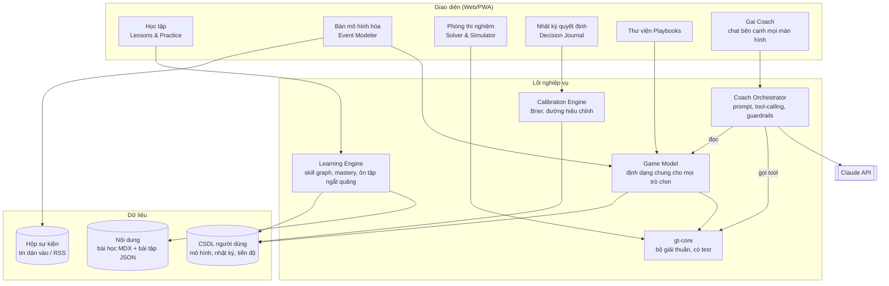
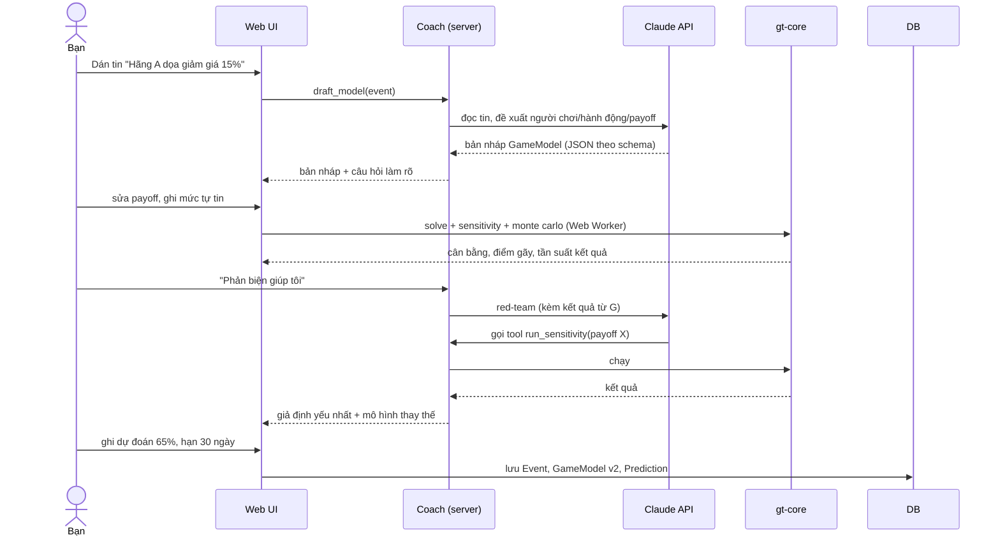

# GAI – Kiến trúc hệ thống

> Ứng dụng giúp người dùng học và áp dụng tư duy lý thuyết trò chơi để phân tích sự kiện thế giới và ra quyết định (đầu tư, quản trị rủi ro, kinh doanh, đàm phán).
>
> Phiên bản: 0.2 (đã chốt hướng chính, xem mục 0) · Ngày: 2026-11-03

---

## 0. Các quyết định đã chốt

| # | Chủ đề | Quyết định | Ảnh hưởng đến kiến trúc |
|---|--------|-----------|------------------------|
| D1 | Nền tảng | **Ưu tiên điện thoại** | Thiết kế mobile-first; PWA cài lên màn hình chính, chạy được khi mất mạng; đóng gói lên App Store/Google Play bằng Capacitor khi thương mại |
| D2 | Người dùng | Ban đầu dùng cá nhân → bạn bè → có thể thương mại | Có tài khoản và phân quyền dữ liệu ngay từ đầu (Supabase Auth + Postgres + RLS); điều khoản sử dụng và tuyên bố "không phải tư vấn đầu tư"; thanh toán để sau |
| D3 | AI | Dùng Claude API, **nhưng không bắt buộc cho lõi**. Phần học, bộ giải và nhật ký chạy không cần AI. AI bật từ giai đoạn P2 | Lõi chạy offline; AI chỉ chạy qua server, có giới hạn mức dùng theo người dùng |
| D4 | Nền toán | Đã lâu không dùng toán → **thêm module "Nền tảng toán"** và bài kiểm tra xếp lớp | Thêm Cấp 0A (mục 3.1) |
| D5 | Ngôn ngữ | Chỉ tiếng Việt | Toàn bộ chữ trên giao diện để trong một file; bảng thuật ngữ ghi kèm tên gốc nhỏ để tra cứu thêm khi cần |
| D7 | Đối tượng | **Cả gia đình, kể cả trẻ em** (yêu cầu 2026-11-03) | Hồ sơ gia đình trên máy, không cần email; lời lẽ đơn giản, ví dụ đời thường trước; thẻ "Áp dụng thực tế" (đầu tư) ẩn với hồ sơ dưới 15 tuổi; linh vật Gai 🦉 + nút ❓ hướng dẫn mỗi màn hình; nút lớn, chữ 17px; giao diện sáng dịu mặc định |
| D6 | Nguồn sự kiện | Ứng dụng **tự đề xuất tin quan trọng, có khả năng áp dụng cao** | Thêm module Radar sự kiện (mục 3.7), cần server chạy theo lịch |

---

## 1. Mục tiêu và phạm vi

### 1.1 Ứng dụng phải làm được

| # | Mục tiêu | Đo bằng gì |
|---|----------|-----------|
| G1 | Dạy từ con số 0 đến mức tự mô hình hóa được một tình huống thực | Tỷ lệ hoàn thành bài, điểm mastery theo từng kỹ năng |
| G2 | Biến một sự kiện thực (tin tức, đàm phán, cạnh tranh) thành mô hình có giả định rõ ràng | Số mô hình hoàn chỉnh, đủ 7 bước checklist |
| G3 | Tính toán đúng (cân bằng, suy luận ngược, độ nhạy) thay vì "cảm giác" | Bộ giải có test, kết quả tái lập được |
| G4 | Đo xem tư duy có thật sự tốt lên không | Brier score, đường hiệu chỉnh theo thời gian |
| G5 | Có người phản biện (AI coach) chỉ ra giả định yếu | Số giả định bị phát hiện/sửa |

### 1.2 Ứng dụng KHÔNG làm

- Không đưa khuyến nghị mua/bán tài sản cụ thể. Ứng dụng giúp suy nghĩ; quyết định là của người dùng.
- Không hứa "dự đoán thế giới". Mọi kết luận kèm giả định và mức tự tin.
- Không ép mọi sự kiện thành trò chơi: có bước "cổng phân loại" chuyển sang phân tích quyết định/xác suất khi không có đối thủ chiến lược.

---

## 2. Bức tranh tổng thể



Nguyên tắc cốt lõi: **AI không tự tính toán**. Mọi con số (cân bằng, payoff kỳ vọng, độ nhạy) đến từ `gt-core` – code thuần, có test. AI chỉ hỏi, giải thích, phản biện và gọi bộ giải qua tool. Như vậy kết quả luôn kiểm chứng được và không bị "ảo giác số".

---

## 3. Sáu module chức năng

### 3.1 Learning Engine (Lộ trình học)

**Skill graph** – mỗi kỹ năng là một nút, có điều kiện tiên quyết. Không mở bài mới khi bài trước chưa đạt mastery.

**Bài kiểm tra xếp lớp** (10–15 phút, khi mở app lần đầu): xác định bạn cần bắt đầu từ Cấp 0A hay bỏ qua được phần nào. Bài làm lại được bất cứ lúc nào.

| Cấp | Chủ đề | Kỹ năng đầu ra | Ví dụ thực |
|-----|--------|----------------|-----------|
| 0A | **Nền tảng toán** (ôn lại từ đầu, không cần biết trước) | Phần trăm & tỷ lệ; xác suất qua đếm và hình ảnh; xác suất kết hợp ("và", "hoặc"); giá trị kỳ vọng; đọc bảng và biểu đồ; cập nhật niềm tin bằng "bảng tần suất" (Bayes không cần công thức) | Xổ số có đáng mua không? Xét nghiệm dương tính thì khả năng mắc bệnh là bao nhiêu? |
| 0 | Tư duy quyết định | Xác suất, giá trị kỳ vọng, cây quyết định, thiên kiến | Có nên mua bảo hiểm? |
| 1 | Trò chơi đồng thời | Ma trận payoff, chiến lược trội, Nash thuần & hỗn hợp | Cuộc chiến giá giữa 2 hãng |
| 2 | Trò chơi tuần tự | Cây trò chơi, suy luận ngược, đe dọa/cam kết đáng tin | Doanh nghiệp mới gia nhập thị trường |
| 3 | Trò chơi lặp | Uy tín, tit-for-tat, hợp tác dài hạn, chiết khấu tương lai | OPEC, quan hệ nhà cung cấp |
| 4 | Thông tin bất đối xứng | Bayes, tín hiệu, sàng lọc, lựa chọn bất lợi | Ngân hàng trung ương "ra tín hiệu" |
| 5 | Đấu giá & thiết kế cơ chế | Các loại đấu giá, lời nguyền người thắng, thiết kế khuyến khích | Đấu thầu, chính sách thưởng |
| 6 | Tiến hóa & hành vi | Replicator dynamics, giới hạn duy lý, hiệu ứng đám đông | Bong bóng tài sản, bank run |
| 7 | Tổng hợp | Phân tích sự kiện thật từ đầu đến cuối, so sánh nhiều mô hình | Căng thẳng thương mại, chiến tranh giá chip |

**Cấu trúc một bài học** (cố định, để người mới không bị lạc):

1. Câu chuyện mở đầu (1 tình huống thực)
2. Khái niệm (ngắn, có hình tương tác)
3. Ví dụ có lời giải từng bước
4. Bài tập có phản hồi tức thì (ma trận tương tác, kéo thả, chọn đáp án, nhập số)
5. Bài "chuyển giao": áp dụng vào một sự kiện khác lĩnh vực
6. Kiểm tra mastery (≥ 80% mới mở bài sau)

**Thiết kế cho điện thoại**: mỗi bài học là chuỗi thẻ ngắn (3–7 phút), vuốt để chuyển; mỗi ngày có 1 phiên "luyện 10 phút" (ôn tập + 1 bài mới); ma trận và cây trò chơi chạm được, phóng to được.

**Nguyên tắc nền toán**: dạy bằng hình và đếm trước, công thức sau; mọi con số gắn với tình huống tiền bạc hoặc đời sống; có bàn phím số và máy tính nhỏ ngay trong bài tập.

**Cơ chế ghi nhớ**: ôn tập ngắt quãng (thuật toán FSRS) cho từng kỹ năng; bài ôn trộn nhiều chủ đề để buộc nhận diện "đây là loại trò chơi gì".

**Các loại bài tập** (mỗi loại là một component + schema JSON riêng):
`multiple_choice`, `numeric`, `matrix_fill` (điền payoff), `find_equilibrium` (bấm chọn ô cân bằng), `tree_backward` (suy luận ngược trên cây), `classify_game` (nhận diện loại trò chơi), `model_critique` (tìm giả định sai trong mô hình cho sẵn), `free_text` (AI chấm theo rubric).

### 3.2 Event Modeler (Bàn mô hình hóa sự kiện)

Quy trình bắt buộc, dạng wizard:

```
0. Nhập sự kiện (chọn từ Radar sự kiện, dán tin, link, hoặc tự mô tả)
1. CỔNG PHÂN LOẠI: Có ít nhất 2 bên ra quyết định và kết quả phụ thuộc lẫn nhau không?
     ├─ Không → chuyển sang "Phân tích quyết định" (cây quyết định, kịch bản xác suất)
     └─ Có ↓
2. Người chơi: ai? (gộp/tách nhóm thế nào?)
3. Hành động: mỗi bên làm được gì?
4. Mục tiêu & payoff: họ thật sự muốn gì? (ước lượng + khoảng sai số)
5. Thông tin: ai biết gì? có bên nào giấu thông tin?
6. Thời điểm: đồng thời hay tuần tự? ai đi trước?
7. Lặp lại: chơi một lần hay lặp? tương lai quan trọng đến đâu?
→ Chọn mẫu trò chơi phù hợp → Giải → Phân tích độ nhạy → Kết luận + dự đoán có xác suất
→ (tùy chọn) Đẩy dự đoán sang Nhật ký quyết định
```

Ràng buộc chất lượng:
- Mỗi payoff phải ghi **nguồn ước lượng** và **mức tự tin** (thấp/vừa/cao).
- Bắt buộc tạo **ít nhất 2 mô hình thay thế** trước khi kết luận (ví dụ: "tù nhân" vs "săn hươu").
- Mô hình có **phiên bản**: khi có tin mới, tạo phiên bản mới, giữ lịch sử để so sánh tư duy trước/sau.

### 3.3 Solver & Simulator (`gt-core`)

Thư viện TypeScript thuần, không phụ thuộc UI, chạy được cả trên trình duyệt (Web Worker) và server.

| Nhóm | Thuật toán | Dùng cho |
|------|-----------|----------|
| Dạng chuẩn (ma trận) | Loại chiến lược bị trội lặp; Nash thuần; Nash hỗn hợp (2×2 giải tích, 2 người n×m: support enumeration / Lemke-Howson) | Cấp 1 |
| Dạng mở rộng (cây) | Suy luận ngược, SPE, kiểm tra đe dọa đáng tin | Cấp 2 |
| Lặp lại | Giải đấu chiến lược kiểu Axelrod, điều kiện chiết khấu duy trì hợp tác | Cấp 3 |
| Bayes | Cập nhật niềm tin, cân bằng Bayes đơn giản (số loại nhỏ) | Cấp 4 |
| Đấu giá | Mô phỏng first/second price, all-pay; giá trị kỳ vọng người bán | Cấp 5 |
| Tiến hóa | Replicator dynamics, mô phỏng quần thể | Cấp 6 |
| Độ bền kết luận | **Phân tích độ nhạy** (quét từng payoff ±x%), **Monte Carlo** (payoff là phân phối, đếm tần suất mỗi cân bằng), **điểm gãy** (payoff nào đổi bao nhiêu thì kết luận đổi) | Mọi cấp |

Yêu cầu kỹ thuật:
- Mọi hàm là hàm thuần: `input (GameModel) → output (Solution + các bước giải thích)`.
- Mỗi lời giải trả kèm `steps[]` để UI và AI dùng giải thích từng bước cho người học.
- Test bằng bộ trò chơi kinh điển có đáp án biết trước + property-based test (ví dụ: Nash tìm được thì không bên nào lệch có lợi).
- Tính toán nặng (Monte Carlo) chạy trong Web Worker để không đơ giao diện.

### 3.4 Decision Journal & Calibration (Nhật ký và hiệu chỉnh)

Mỗi mục nhật ký:
- Câu hỏi dự đoán **đo được, có hạn** ("Đến 31/03/2027, hãng A có giảm giá ≥ 10% không?")
- Xác suất bạn đưa ra (0–100%)
- Mô hình liên kết (nếu có) và lý do
- Ngày đến hạn → nhắc đối chiếu
- Kết quả thực + bài học rút ra

Chỉ số:
- **Brier score** tổng và theo lĩnh vực
- **Đường hiệu chỉnh**: khi bạn nói 70%, thực tế đúng bao nhiêu %?
- Thiên kiến phát hiện được: quá tự tin, né xác suất cực trị, chỉ đúng ở một lĩnh vực
- So sánh "dự đoán có dùng mô hình" vs "dự đoán theo cảm giác" → trả lời câu hỏi lý thuyết trò chơi có thật sự giúp bạn không

### 3.5 Playbooks (Thư viện theo lĩnh vực)

Mỗi playbook = mẫu mô hình dựng sẵn + câu hỏi gợi ý + lỗi thường gặp + bài tập.

| Lĩnh vực | Mẫu trò chơi điển hình |
|----------|-----------------------|
| Đầu tư | Beauty contest Keynes, bank run, đánh giá động cơ ban lãnh đạo, chính sách NHTW và kỳ vọng thị trường |
| Quản trị rủi ro | Phản ứng đối thủ, đối tác phá vỡ hợp đồng, rủi ro đạo đức, bảo hiểm và lựa chọn bất lợi |
| Chiến lược kinh doanh | Chiến tranh giá, gia nhập/răn đe gia nhập, đi trước hay theo sau, liên minh |
| Đàm phán | BATNA, cam kết đáng tin, chia bánh Rubinstein, đàm phán nhiều vòng |
| Địa chính trị | Răn đe, leo thang (chicken), trừng phạt kinh tế, liên minh |
| Cá nhân | Thương lượng lương, chọn sản phẩm tài chính, cam kết tự kỷ luật |

### 3.6 Gai Coach (Huấn luyện viên AI)

**Có cần AI không?** Không bắt buộc cho phần lõi, nhưng là thứ tạo khác biệt lớn nhất.

| Không có AI vẫn làm được | Chỉ có AI mới làm tốt |
|--------------------------|----------------------|
| Học toàn bộ bài học, bài tập có đáp án sẵn | Hỏi gợi mở đúng chỗ bạn đang vướng |
| Giải ma trận, cây, độ nhạy, Monte Carlo | Chấm câu trả lời tự luận ("vì sao bên A sẽ không giảm giá?") |
| Nhật ký dự đoán, Brier score | Đọc tin tức và dựng bản nháp mô hình |
| Playbook mẫu | Phản biện, tìm giả định yếu, đề xuất mô hình thay thế |
| | Lọc và tóm tắt tin cho Radar sự kiện (mục 3.7) |

Vì vậy: P0–P1 xây không cần AI (rẻ, chạy offline). Từ P2 mới bật AI. Chi phí tính theo lượng dùng, kiểm soát bằng: model nhẹ cho việc đơn giản, cache prompt, giới hạn lượt/ngày cho mỗi tài khoản. Khi thương mại, chi phí AI là cơ sở để định giá gói trả phí.

Chạy trên Claude API (đề xuất `claude-sonnet-5-5` cho hội thoại thường, `claude-opus-5-5` cho phản biện mô hình phức tạp).

**Các chế độ:**

| Chế độ | Hành vi |
|--------|---------|
| Socratic (mặc định khi học) | Không đưa đáp án ngay; hỏi gợi mở theo bậc, chỉ giải khi người học bí sau 2–3 lần |
| Giải thích | Giải thích lời giải từ `steps[]` của bộ giải, bằng ví dụ đời thường |
| Phản biện (red team) | Tìm giả định yếu nhất, đề xuất mô hình thay thế, chỉ ra người chơi bị bỏ sót |
| Dựng mô hình | Đọc tin tức người dùng dán vào, đề xuất bản nháp người chơi/hành động/payoff để người dùng sửa |
| Chấm bài tự luận | Chấm theo rubric có sẵn, trả điểm + nhận xét |

**Tool mà Coach được gọi** (function calling):
`solve_normal_form`, `solve_extensive_form`, `run_sensitivity`, `run_monte_carlo`, `run_tournament`, `get_user_model`, `propose_model_patch` (đề xuất sửa, người dùng phải bấm chấp nhận), `get_learner_profile` (điểm yếu hiện tại để cá nhân hóa).

**Guardrails:**
- Không khuyến nghị mua/bán tài sản cụ thể; khi bị hỏi, chuyển về phân tích động cơ các bên và nhắc trách nhiệm quyết định.
- Mọi con số phải đến từ tool; prompt hệ thống cấm tự tính cân bằng.
- Luôn ghi rõ "giả định" vs "dữ kiện".
- Khi sự kiện không phải trò chơi, nói thẳng và chuyển sang công cụ khác.

**Bộ nhớ người học** (do app quản lý, không phải do AI tự nhớ): kỹ năng yếu, lỗi lặp lại, lĩnh vực quan tâm → đưa vào ngữ cảnh mỗi phiên.

### 3.7 Radar sự kiện (tin quan trọng, áp dụng được)

Mục tiêu: mỗi ngày đề xuất **3–5 sự kiện** đáng phân tích nhất, chứ không phải đổ cả trăm tin.

**Quy trình chạy theo lịch (mỗi sáng):**

```
Thu thập  →  Gom cụm  →  Chấm điểm  →  Chọn lọc  →  Chuẩn bị
(RSS/API     (gộp các     (AI chấm     (top 3–5,    (tóm tắt, người chơi
 nguồn tin    bài cùng     theo 6       đa dạng      dự kiến, loại trò chơi
 đã duyệt)    sự kiện)     tiêu chí)    lĩnh vực)    gợi ý, câu hỏi dự đoán mẫu)
```

**6 tiêu chí chấm điểm "đáng phân tích"** (mỗi tiêu chí 0–3 điểm):

| Tiêu chí | Câu hỏi |
|----------|---------|
| Tính chiến lược | Có ≥ 2 bên ra quyết định và kết quả phụ thuộc lẫn nhau? (không có → loại) |
| Đang diễn ra | Các bên còn chưa ra quyết định cuối cùng? (tin đã ngã ngũ ít giá trị) |
| Tác động | Ảnh hưởng đến thị trường, doanh nghiệp, kinh tế Việt Nam hoặc túi tiền cá nhân? |
| Dự đoán được | Có thể đặt câu hỏi đo được, có hạn (≤ 3 tháng) để đối chiếu? |
| Giá trị học | Minh họa rõ một khái niệm (răn đe, tín hiệu, trò chơi lặp...)? Ưu tiên khái niệm bạn đang học |
| Hợp sở thích | Thuộc lĩnh vực bạn chọn theo dõi? |

**Nhóm sự kiện thường có giá trị áp dụng cao:**

| Nhóm | Ví dụ dạng sự kiện | Khái niệm minh họa |
|------|-------------------|--------------------|
| Chính sách tiền tệ | Fed, Ngân hàng Nhà nước điều chỉnh lãi suất, tỷ giá | Tín hiệu, kỳ vọng, uy tín cam kết |
| Thương mại & thuế quan | Đàm phán thuế quan, trừng phạt, hạn chế xuất khẩu | Leo thang, răn đe, đàm phán nhiều vòng |
| Hàng hóa | OPEC+ quyết định sản lượng dầu, giá vàng, giá gạo | Cartel, trò chơi lặp, gian lận hợp tác |
| Cạnh tranh doanh nghiệp | Chiến tranh giá (gọi xe, thương mại điện tử, viễn thông, ngân hàng) | Bertrand, răn đe gia nhập, tù nhân |
| Thâu tóm & sáp nhập | Chào mua công khai, tranh giành cổ phần | Đấu giá, lời nguyền người thắng |
| Thị trường tài chính | Bán tháo, rút tiền hàng loạt, xử lý trái phiếu, bất động sản | Bank run, beauty contest, trò chơi phối hợp |
| Công nghệ | Cuộc đua chip, AI, tiêu chuẩn công nghệ | Đi trước/đi sau, hiệu ứng mạng |
| Địa chính trị | Xung đột, liên minh, bầu cử lớn | Chicken, cam kết đáng tin, liên minh |
| Lao động & đàm phán | Đình công, thương lượng lương, đàm phán hợp đồng lớn | BATNA, chia bánh, chiến tranh tiêu hao |

**Mỗi thẻ sự kiện trên điện thoại** gồm: tóm tắt 3 dòng, link bài gốc, các bên chính, loại trò chơi gợi ý, khái niệm liên quan (bấm vào mở bài học), câu hỏi dự đoán mẫu, nút "Phân tích ngay" (mở Event Modeler) và nút "Theo dõi" (báo khi có diễn biến mới).

**Nguồn tin**: danh sách nguồn được duyệt trước (báo kinh tế Việt Nam và hãng tin quốc tế có RSS/API hợp lệ), người dùng bật/tắt từng nguồn được. Danh sách cụ thể chốt ở giai đoạn P4.

**Bản quyền & pháp lý**: chỉ lưu tiêu đề, link, ngày đăng và tóm tắt ngắn do AI viết; không sao chép toàn văn bài báo. Điều này đặc biệt quan trọng khi thương mại.

**Chống thao túng**: nội dung bài báo được đưa cho AI như dữ liệu, tách khỏi chỉ dẫn hệ thống; tiêu chí chấm điểm cố định trong code, không để bài báo thay đổi.

---

## 4. Mô hình dữ liệu chính

### 4.1 `GameModel` – định dạng chung (trái tim của hệ thống)

Một schema duy nhất (định nghĩa bằng Zod) dùng chung cho bài học, Event Modeler, bộ giải và AI.

```ts
type GameModel = {
  id: string;
  version: number;
  title: string;
  kind: "normal_form" | "extensive_form" | "repeated" | "bayesian" | "auction" | "evolutionary";
  players: Player[];               // { id, name, description, goals }
  actions: Record<PlayerId, Action[]>;
  payoffs: PayoffSpec;             // ma trận hoặc gắn vào lá của cây
  information: InfoSpec;           // ai biết gì, information sets, prior
  timing: "simultaneous" | "sequential";
  repetition?: { rounds: number | "infinite"; discount: number };
  assumptions: Assumption[];       // { text, confidence: "low"|"mid"|"high", source }
  uncertainty?: PayoffDistribution;// cho Monte Carlo: min / likely / max
  alternatives?: string[];         // id các mô hình thay thế
  linkedEventId?: string;
};
```

Payoff lưu dạng `{ value, low, high, confidence, rationale }` – không bao giờ chỉ là một con số trơn.

### 4.2 Các thực thể khác

```
User ─┬─ LearnerProfile (kỹ năng, mastery, lịch ôn)
      ├─ Attempt (bài tập đã làm, đúng/sai, thời gian, gợi ý đã dùng)
      ├─ RadarPrefs (nguồn tin bật/tắt, lĩnh vực theo dõi)
      ├─ Event (sự kiện: nguồn, tóm tắt, thẻ lĩnh vực, ngày)
      │    └─ GameModel (nhiều phiên bản, nhiều mô hình thay thế)
      │         └─ SolveRun (đầu vào, kết quả, độ nhạy — lưu để tái lập)
      ├─ Prediction (câu hỏi, xác suất, hạn, kết quả, Brier, modelId?)
      └─ CoachThread (hội thoại, gắn với bài học / mô hình / dự đoán)

Dữ liệu dùng chung (mọi người dùng cùng xem):
  RadarItem (tiêu đề, link, tóm tắt AI, điểm 6 tiêu chí, loại trò chơi gợi ý, ngày)
  RadarCluster (gom các tin cùng một sự kiện, theo dõi diễn biến)

Content (không nằm trong DB người dùng, quản lý bằng git):
  Skill (nút trong skill graph, tiên quyết)
  Lesson (MDX) → Exercise (JSON theo schema) → Rubric
  Playbook → GameModel mẫu
```

---

## 5. Kiến trúc kỹ thuật

### 5.1 Lựa chọn công nghệ (đề xuất mặc định)

| Lớp | Công nghệ | Lý do |
|-----|-----------|-------|
| Ngôn ngữ | TypeScript toàn bộ | Một ngôn ngữ cho UI, bộ giải, server; schema dùng chung |
| Frontend | Next.js (React) + Tailwind + shadcn/ui, **thiết kế mobile-first** | Phổ biến, nhiều tài liệu, làm PWA dễ |
| Ứng dụng điện thoại | PWA (cài lên màn hình chính, chạy offline, thông báo đẩy) → Capacitor để đưa lên App Store/Google Play | Một mã nguồn cho web và điện thoại; không phải viết app riêng |
| Dữ liệu offline | IndexedDB trên máy, đồng bộ lên server khi có mạng | Học trên xe, chỗ mạng yếu |
| Hình tương tác | SVG/D3 cho ma trận & cây trò chơi; Recharts cho biểu đồ | Bài học cần hình tương tác |
| Nội dung | MDX + JSON exercises trong repo | Viết bài như viết văn bản, có version control |
| Validation | Zod | Một schema dùng cho form, API, tool của AI |
| CSDL & tài khoản | Supabase (Postgres + Auth + Row Level Security) từ đầu, Drizzle ORM | Sẵn sàng cho nhiều người dùng; mỗi người chỉ thấy dữ liệu của mình |
| Tác vụ theo lịch | Cron (Vercel Cron hoặc Supabase Scheduled Functions) | Radar sự kiện chạy mỗi sáng, nhắc hạn dự đoán |
| Hosting | Vercel (web) + Supabase | Gói miễn phí đủ cho giai đoạn cá nhân và bạn bè |
| AI | Anthropic SDK, tool calling, streaming | Coach + đọc tin tức |
| Tính toán nặng | Web Worker | Không đơ giao diện |
| Test | Vitest (gt-core, logic), Playwright (luồng chính) | Bộ giải bắt buộc có test |

### 5.2 Cấu trúc thư mục (monorepo, npm workspaces)

Triển khai: GitHub Pages → `gai.thuankhoi.com` (chi tiết trong [DEPLOY.md](DEPLOY.md)).

```
GAMETHEORY APP/
├─ apps/
│  └─ web/                    # Next.js: UI + API routes
│     ├─ app/(learn)/         # lộ trình, bài học, ôn tập
│     ├─ app/(model)/         # Event Modeler, Lab
│     ├─ app/(journal)/       # nhật ký, hiệu chỉnh
│     ├─ app/(playbooks)/
│     ├─ app/(radar)/         # Radar sự kiện
│     ├─ app/api/coach/       # endpoint AI (giữ API key ở server)
│     └─ app/api/cron/        # tác vụ theo lịch: radar, nhắc hạn
├─ packages/
│  ├─ gt-core/                # bộ giải thuần + test
│  ├─ schema/                 # Zod: GameModel, Exercise, Prediction...
│  ├─ learning/               # skill graph, mastery, FSRS
│  ├─ calibration/            # Brier, đường hiệu chỉnh
│  ├─ coach/                  # prompt, định nghĩa tool, guardrails
│  ├─ radar/                  # thu thập, gom cụm, chấm điểm tin
│  ├─ ui-game/                # component: MatrixEditor, GameTree, PayoffSlider
│  └─ db/                     # schema DB + migration
├─ content/
│  ├─ skills.yaml             # skill graph
│  ├─ lessons/level-0..7/     # MDX
│  ├─ exercises/              # JSON
│  └─ playbooks/
└─ docs/
   └─ ARCHITECTURE.md
```

Quy tắc phụ thuộc (một chiều, để hệ thống không rối khi lớn):

```
schema  ←  gt-core  ←  coach
   ↑          ↑          ↑
learning  calibration  ui-game  ←  apps/web
```
`gt-core` và `schema` không bao giờ import từ UI hay DB.

### 5.3 Luồng xử lý tiêu biểu: phân tích một sự kiện



### 5.4 Bảo mật & quyền riêng tư

- API key Claude chỉ nằm ở server, không bao giờ gửi xuống trình duyệt.
- Tài khoản và Row Level Security từ đầu: mỗi người dùng chỉ đọc/ghi được dữ liệu của chính mình. Dữ liệu nhật ký (có thể chứa quyết định tài chính cá nhân) mã hóa khi truyền.
- Giới hạn lượt dùng AI theo tài khoản để tránh lạm dụng và kiểm soát chi phí.
- Trước khi chia sẻ cho người khác: có điều khoản sử dụng, chính sách quyền riêng tư, tuyên bố "nội dung mang tính giáo dục, không phải tư vấn đầu tư", và nút xóa tài khoản kèm toàn bộ dữ liệu.
- Nội dung tin tức dán vào được coi là dữ liệu: prompt tách rõ "nội dung bài báo" khỏi "chỉ dẫn", để tin có câu lệnh cài cắm không điều khiển được AI.
- Xuất/nhập toàn bộ dữ liệu ra JSON để sao lưu.

---

## 6. Nguyên tắc thiết kế sản phẩm

1. **Giả định luôn hiện**: không có màn kết luận nào thiếu danh sách giả định và mức tự tin.
2. **Hai mô hình trở lên**: không kết luận từ một mô hình duy nhất.
3. **Độ bền trước kết luận**: luôn hiện "kết luận đổi khi nào".
4. **Đo bằng kết quả thật**: tiến bộ đo bằng Brier score, không bằng số bài đã đọc.
5. **Cổng phân loại**: biết khi nào lý thuyết trò chơi không phải công cụ đúng.
6. **Học bằng làm**: mỗi khái niệm đi kèm thao tác tương tác, không chỉ đọc.
7. **AI là người phản biện, không phải nhà tiên tri**.

---

## 7. Lộ trình xây dựng

| Giai đoạn | Phạm vi | Xong khi |
|-----------|---------|----------|
| **P0 – Nền móng** | Monorepo, `schema`, `gt-core` dạng ma trận (trội, Nash thuần + hỗn hợp 2×2), MatrixEditor chạm được trên điện thoại, khung PWA, Supabase + đăng nhập | Cài được lên điện thoại; giải đúng 10 trò chơi kinh điển, test xanh |
| **P1 – MVP học (không cần AI)** | Bài xếp lớp, **Cấp 0A Nền toán**, Cấp 0–2 (~20 bài), bài tập tương tác, mastery gate, phiên luyện 10 phút/ngày, suy luận ngược trên cây, Nhật ký dự đoán + Brier | Bạn học hết Cấp 0A–2 trên điện thoại và ghi được ≥ 10 dự đoán |
| **P2 – Coach** | Gai Coach chế độ Socratic + giải thích + chấm tự luận, tool gọi `gt-core`, giới hạn lượt dùng | Coach không bao giờ đưa số tự tính; trả lời đúng chế độ |
| **P3 – Mô hình hóa sự kiện** | Event Modeler 7 bước (giao diện từng bước cho điện thoại), cổng phân loại, phiên bản mô hình, độ nhạy + Monte Carlo, chế độ phản biện | Phân tích trọn vẹn 3 sự kiện thật từ tin đến dự đoán |
| **P4 – Radar sự kiện** | Chốt danh sách nguồn, thu thập theo lịch, gom cụm, chấm 6 tiêu chí, thẻ sự kiện, theo dõi diễn biến, thông báo đẩy | Mỗi sáng có 3–5 sự kiện đáng phân tích, bạn thấy ≥ 1 cái hữu ích mỗi ngày |
| **P5 – Mở rộng kiến thức** | Cấp 3–6: trò chơi lặp (giải đấu), Bayes, đấu giá, tiến hóa; 6 playbook | Đủ bộ giải và bài học cho từng cấp |
| **P6 – Chia sẻ & thương mại** | Mời bạn bè dùng thử, thu phản hồi, đo chỉ số hiệu quả (mục 9), điều khoản pháp lý, đóng gói lên kho ứng dụng, gói trả phí | Có bằng chứng app giúp người dùng ra quyết định tốt hơn |

Sau mỗi giai đoạn: dùng thật vài tuần, xem nhật ký hiệu chỉnh, rồi mới làm giai đoạn sau.

---

## 8. Rủi ro và cách giảm

| Rủi ro | Giảm thiểu |
|--------|-----------|
| Ảo tưởng "đã mô hình hóa nên đã hiểu" | Bắt buộc độ nhạy, mô hình thay thế, đo Brier |
| AI tính sai hoặc bịa số | Mọi tính toán qua `gt-core`; test bộ giải |
| Nội dung bài học sai/khó hiểu | Nội dung trong git, có test cho đáp án bài tập; viết dần theo cấp, sửa theo phản hồi |
| Chi phí API AI tăng | Dùng model nhẹ cho việc đơn giản, cache prompt hệ thống, giới hạn theo ngày |
| Phạm vi quá lớn, không bao giờ xong | Làm theo giai đoạn, mỗi giai đoạn dùng được ngay |
| Bị dùng như công cụ khuyến nghị đầu tư | Guardrail trong Coach + nhắc rõ trong UI |

---

## 9. Chỉ số thành công của chính ứng dụng

- Mastery: % kỹ năng đạt ≥ 80% và giữ được sau ôn tập.
- Hiệu chỉnh: Brier score giảm dần theo quý; đường hiệu chỉnh tiến gần đường chéo.
- Thói quen: số sự kiện được mô hình hóa mỗi tháng; tỷ lệ dự đoán được đối chiếu đúng hạn.
- Giá trị thực: dự đoán có mô hình chính xác hơn dự đoán theo cảm giác bao nhiêu.

---

## 10. Phần mở rộng có thể cân nhắc sau

- Chơi đối kháng với bot (tù nhân lặp, đấu giá) để cảm nhận chiến lược.
- Chế độ nhóm: nhiều người cùng mô hình hóa một sự kiện rồi so sánh.
- Xuất mô hình thành báo cáo (PDF) để trình bày.
- Kết nối dữ liệu thị trường (chỉ để tham khảo bối cảnh, không khuyến nghị).

---

## 11. Thuật ngữ

| Thuật ngữ | Nghĩa ngắn |
|-----------|-----------|
| Payoff | Lợi ích mỗi bên nhận được ở mỗi kết cục |
| Cân bằng Nash | Trạng thái không bên nào muốn đổi chiến lược khi các bên khác giữ nguyên |
| Suy luận ngược | Giải trò chơi tuần tự từ bước cuối ngược về đầu |
| SPE | Cân bằng hoàn hảo trò chơi con – loại bỏ các đe dọa không đáng tin |
| Brier score | Điểm đo độ chính xác dự đoán xác suất (càng thấp càng tốt) |
| Mastery | Mức thành thạo một kỹ năng, mở khóa bài tiếp theo |

---

## 12. Câu hỏi còn mở

Các câu hỏi lớn đã chốt ở mục 0. Còn lại:

1. **Lĩnh vực ưu tiên**: đầu tư, kinh doanh, hay địa chính trị? Dùng để chọn ví dụ trong bài học và trọng số "Hợp sở thích" của Radar. Mặc định nếu chưa chốt: đầu tư + kinh doanh, bối cảnh Việt Nam.
2. **Danh sách nguồn tin cụ thể**: chốt ở giai đoạn P4.
